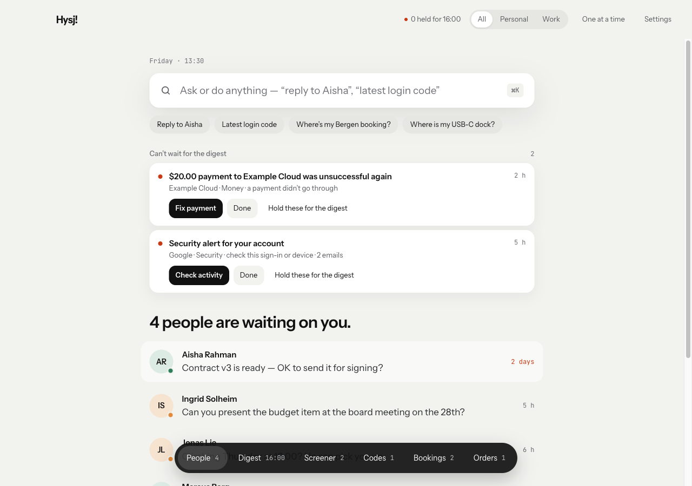
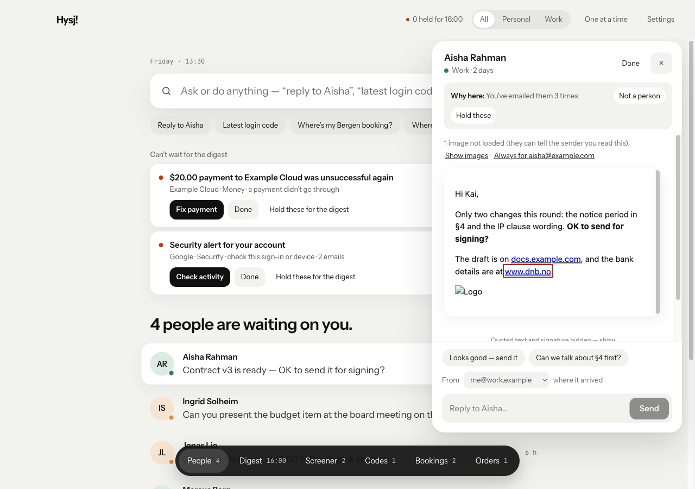
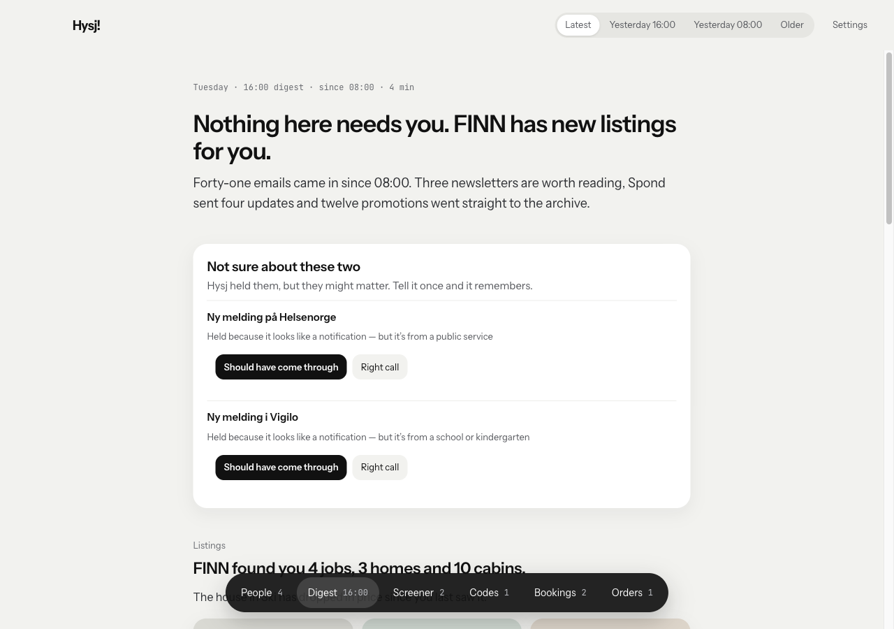
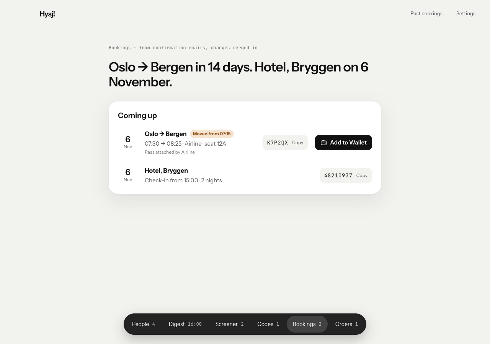
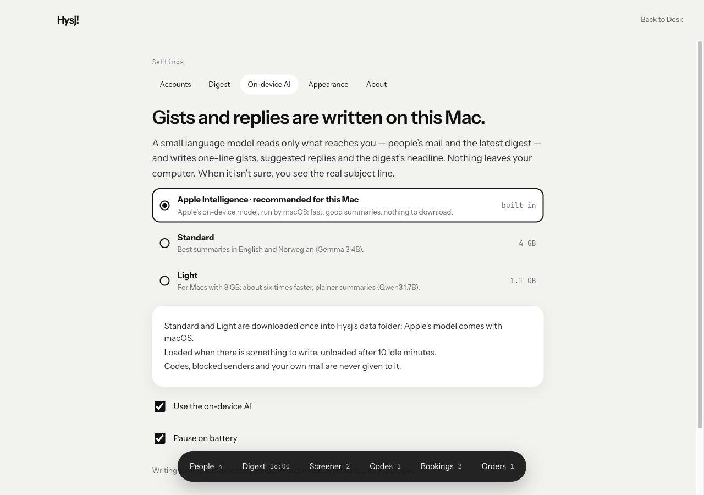
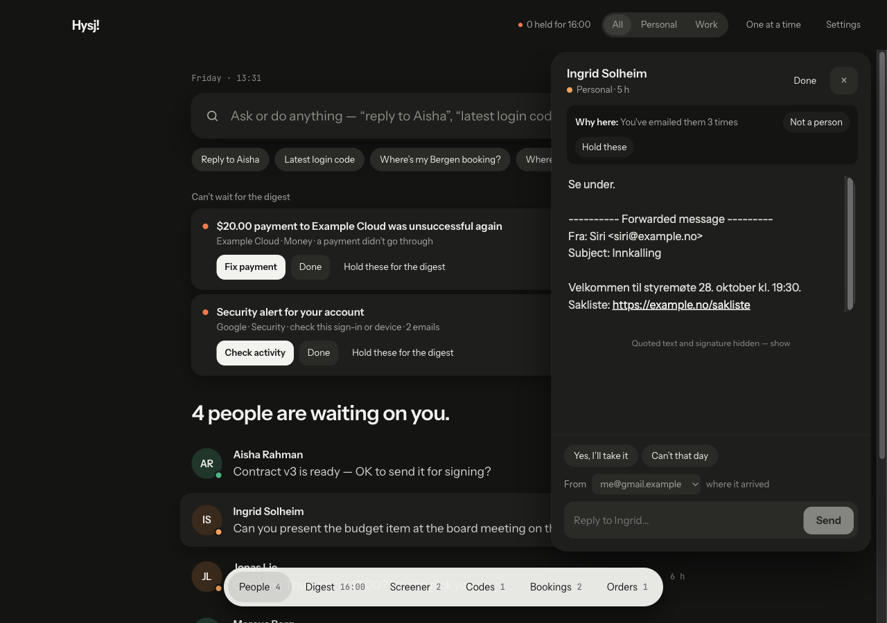

<div align="center">


# Hysj

**A mail client where only people reach you.**<br>
Everything else waits for a digest, at the times you choose.

[](https://github.com/thrandre/hysj/releases/latest)
[](https://github.com/thrandre/hysj/actions/workflows/ci.yml)

[](LICENSE)



</div>

Hysj (Norwegian for "hush") is a desktop mail client built around one idea:
**mail from people you know comes first, and nothing else interrupts you.**
Newsletters, notifications and receipts are held for a digest that reads like
a short newspaper; sign-in codes, bookings and orders are pulled out into
their own places. Your mail, the index and the AI that summarises it all stay
on your Mac.

<sub>Screenshots show made-up mail.</sub>

## A quick tour

### The Desk: people first

The people waiting on you, each with a one-line summary. Open one and the
conversation slides in, with suggested replies and the address it arrived on.
Every email says **why it's here**; one click (*Not a person*, *Hold these*)
teaches Hysj, and Undo is always there. A failed payment or a new sign-in to
your account still gets through: that's the *Can't wait for the digest* list.



### The Digest: everything else, like a short newspaper

At 08:00 and 16:00 (or the times you pick), the held mail arrives as one
edition: a headline, the stories that matter first, newsletters as a reading
list, promotions archived unseen. Every number in it comes from your mail,
never from the AI. FINN alerts become proper listings, with price drops
tracked over time.

<table><tr>
<td></td>
<td></td>
</tr></table>

### Codes, bookings and orders

Sign-in codes pop up and copy with one click, then delete themselves.
Booking and order confirmations become cards (later changes merged in, with
**Add to Wallet** when the airline attached a pass), and order mails turn into
a delivery tracker.



### On-device AI, your choice of model

Summaries, suggested replies and the Digest's headline are written on your
Mac. Use **Apple Intelligence** (built into macOS 26, nothing to download),
**Standard** (Gemma 3 4B) or **Light** (Qwen3 1.7B, for 8 GB Macs). It pauses
on battery, and when it isn't sure you simply see the real subject line.



### Light and dark



## Install

Hysj runs on **Macs with Apple Silicon** (M1 or newer), macOS 14 or later.

1. Download the `.dmg` from the [latest release](https://github.com/thrandre/hysj/releases/latest)
   and drag Hysj to Applications.
2. The builds aren't signed by Apple yet, so macOS blocks the first launch.
   Open **System Settings › Privacy & Security**, scroll down and choose
   **Open Anyway** next to Hysj.
3. After that Hysj updates itself: new versions download in the background
   and install when you restart or quit it. macOS asks for keychain access
   again after each update — choose **Always Allow**.

Then add your mail:

| Provider | How |
|---|---|
| **Gmail** | Sign in with Google in your browser. Google warns that it hasn't verified Hysj: choose **Advanced › Go to Hysj**. |
| **Outlook.com / Hotmail** | Sign in with Microsoft in your browser. |
| **iCloud, Yahoo, Fastmail** | An app password; Hysj shows where to make one. |
| **Anything else** | Your password; Hysj guesses the IMAP/SMTP servers, or you type them in. |

Passwords and sign-ins live in the macOS keychain, never in Hysj's files.

## Build from source

You need [Rust](https://rustup.rs) (stable), [Node.js](https://nodejs.org) 20+
and Xcode 26 (for Apple's on-device model; older Xcode builds Hysj without it).

```sh
git clone https://github.com/thrandre/hysj
cd hysj
cargo run --release
```

Google requires a client secret even for desktop apps, and it isn't in the
repo. Set `HYSJ_GOOGLE_CLIENT_SECRET` when building (or, on a Mac, keep it in
the keychain item `hysj-google-client-secret`); without it, Gmail is added
with the command line and an [app password](https://myaccount.google.com/apppasswords):
`cargo run -p hysj-cli -- account add you@gmail.com`.

## How it's built

A background service (`hysjd`) owns the mail store (SQLite), the IMAP/SMTP
connections and the model; the desktop app (Tauri 2 + Svelte) and the `hysj`
command line are thin clients over a local socket. Mail providers are data
(`hysjd/src/provider.rs`), and Apple's model runs through a small Swift
helper bundled with the app. See [CLAUDE.md](CLAUDE.md) for the full product
and architecture brief.

```sh
cargo test --workspace              # Rust tests
cd crates/hysj-app/ui && npm test   # UI tests
```

## Releasing

1. Bump `version` in the root `Cargo.toml` and commit.
2. Tag with the release notes as the message (after a title line; they're
   what installed copies show as "what's new") and push:
   `git tag -a v0.4.0 -m "Hysj 0.4.0" -m "What changed, in a sentence or two."`
   then `git push origin v0.4.0`.

The Release workflow builds the app on a macOS 26 runner and publishes the
`.dmg` and the signed update that installed copies pick up (`latest.json`).
A local build: `cargo install tauri-cli --version "^2"`, then
`cargo tauri build` in `crates/hysj-app`.

## License

[MIT](LICENSE)
